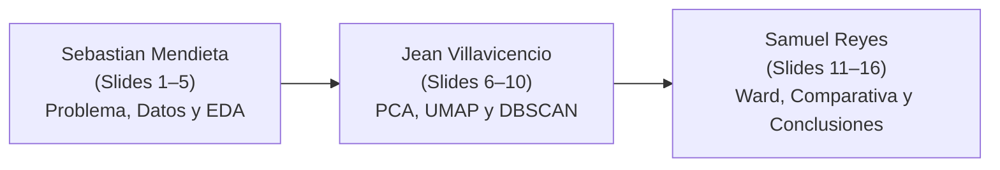

# 🗣️ Guía Maestra para la Defensa Oral: Proyecto de Clustering
## Sistemas Inteligentes · Proyecto Bimestral
**Tema:** Segmentación de pacientes pediátricos con sospecha de apendicitis mediante DBSCAN y Clustering Jerárquico Aglomerativo (con PCA y UMAP)  
**Integrantes:** Sebastian Mendieta · Jean Villavicencio · Samuel Reyes  
**Archivos entregables alineados:** Notebook `proyecto_clustering.ipynb` (56 celdas ejecutadas) y Presentación PPT `Presentacion_Clustering_Apendicitis.pptx` (16 diapositivas).

---

## 🧭 Estructura de la Exposición y Reparto de Roles

---

## 👤 Bloque 1: Problema, Datos, EDA y Preprocesamiento
**Responsable en diapositivas:** Sebastian Mendieta (Diapositivas 1 a 5)

### P1. ¿Por qué el proyecto usa la hoja `Todo` y cuántos pacientes quedaron finalmente?
> **Respuesta modelo:**  
> "La condición asignada a nuestro grupo en `condiciones.txt` fue explícitamente *'todos'*, por lo que trabajamos con la cohorte completa de la hoja `Todo` (782 registros pediátricos, sin filtrar por sexo ni rangos de edad).  
> Sin embargo, durante el preprocesamiento identificamos **8 registros que tenían más del 50 % de sus variables clínicas vacías** (incluyendo filas prácticamente en blanco). Se eliminaron esos 8 registros para evitar distorsiones matemáticas graves en el cálculo de distancias, quedando una matriz de trabajo depurada y representativa de **774 pacientes × 16 variables clínicas**."

### P2. ¿Qué decisiones tomaron con los valores atípicos y los datos imposibles?
> **Respuesta modelo:**  
> "Diferenciamos con rigor dos realidades:
> 1. **Errores de registro fisiológicamente imposibles:** Detectamos 4 anomalías graves (edades registradas en 0 años cuando el estudio es pediátrico a partir de 1.5 años, un BMI de 7.8 en un adolescente y una temperatura corporal de 26.9 °C incompatible con la vida). Estos valores se convirtieron en `NaN` para ser tratados mediante imputación controlada.
> 2. **Atípicos biológicos reales:** La PCR tiene 85 valores por encima del rango intercuartílico (IQR), con un máximo de **365 mg/L**. Estos **se conservaron intactos** porque reflejan cuadros de inflamación severa (apendicitis perforada o peritonitis). Descartarlos habría cegado al algoritmo ante los pacientes más graves."

### P3. ¿Por qué falta el 36 % del diámetro apendicular y por qué imputaron con la mediana?
> **Respuesta modelo:**  
> "En el ámbito de urgencias pediátricas, el diámetro ecográfico del apéndice (`Appendix_Diameter`) no siempre está disponible: el dolor agudo, el llanto, la falta de ecografista las 24 horas o el gas intestinal impiden visualizar el apéndice en más de un tercio de los niños.  
> Imputamos con la **mediana** y no con la media porque variables como la PCR y los leucocitos tienen distribuciones fuertemente asimétricas hacia la derecha (*right-skewed*). La media se deja arrastrar por los valores extremos, mientras que la mediana representa de forma neutral el valor central del paciente."

### P4. ¿Por qué es obligatorio apartar `Diagnosis` y estandarizar con `StandardScaler`?
> **Respuesta modelo:**  
> "1. **Apartar `Diagnosis`:** El clustering es **aprendizaje no supervisado**. Si dejamos la etiqueta diagnóstica dentro del entrenamiento, se produce **fuga de datos (*data leakage*)** y la máquina hace trampa. Apartamos el diagnóstico en `y_true` y lo usamos exclusivamente al final para validar clínicamente la calidad de los clusters.  
> 2. **`StandardScaler`:** DBSCAN y el enlace de Ward calculan **distancias euclidianas**. Variables como la PCR (hasta 365) o los leucocitos (hasta 25 mil) tienen magnitudes gigantescas frente a la temperatura (36 a 38 °C) o los síntomas binarios (0 o 1). Sin estandarizar, la PCR dominaría el 99 % de la distancia euclidiana. Con `StandardScaler`, cada atributo queda con media 0 y varianza 1."

---

## 👤 Bloque 2: Reducción (PCA vs UMAP), Métricas y DBSCAN
**Responsable en diapositivas:** Jean Villavicencio (Diapositivas 6 a 10)

### P5. ¿Por qué el docente pidió PCA y UMAP y qué diferencia conceptual tienen?
> **Respuesta modelo:**  
> "Representan dos paradigmas geométricos completamente opuestos:
> - **PCA es una transformación lineal global:** Busca combinaciones lineales ortogonales que maximicen la varianza. Necesitamos **9 componentes para retener el 81.1 % de la varianza**, lo que demuestra que la información clínica está dispersa en muchas dimensiones. Su primera componente (`PC1`, 25.3 %) actúa como un verdadero **'eje de gravedad inflamatoria'** (cargan Alvarado, PAS, leucocitos y neutrófilos).
> - **UMAP es un algoritmo no lineal de aprendizaje de variedades (*manifold learning*):** Construye un grafo difuso de vecindades en alta dimensión y busca una proyección 2D que preserve quién está cerca de quién. En lugar de proyectar varianza continua, UMAP agrupó a los pacientes que comparten las mismas combinaciones de **síntomas binarios 0/1**, creando islas muy separadas visualmente."

### P6. ¿Cómo se calcula la silueta y qué significa que un punto tenga silueta negativa?
> **Respuesta modelo:**  
> "Para cada paciente $i$, comparamos dos distancias:
> - $a(i)$: distancia promedio a los compañeros de su propio cluster (cohesión interna).
> - $b(i)$: distancia promedio al cluster vecino más cercano (separación externa).
> La fórmula es $s(i) = \frac{b(i) - a(i)}{\max(a(i), b(i))}$, oscilando entre $-1$ y $+1$.  
> - Si $s(i) \approx +1$, el paciente está pegado a su grupo y lejos del resto.  
> - Si $s(i) \approx 0$, está en la frontera entre dos clusters.  
> - Si $s(i) < 0$, significa que **$b(i) < a(i)$**: el paciente está en promedio **más cerca de los miembros de otro cluster que de los del suyo propio**, indicando que fue mal agrupado o que se encuentra en una región de solapamiento clínico."

### P7. ¿Cómo seleccionaron Épsilon (ε) en DBSCAN y por qué fijaron `min_samples = 10`?
> **Respuesta modelo:**  
> "Fijamos **`min_samples = 10`** siguiendo la regla heurística de $D + 1$ (donde $D=9$ componentes de PCA). Para ser metodológicamente consistentes, graficamos las distancias exactamente al **10.º vecino más cercano (10-NN)** en orden ascendente.  
> Para no elegir $\varepsilon$ 'a ojo', aplicamos el algoritmo matemático **Kneedle** (punto de máxima curvatura / distancia a la secante):
> - **En PCA:** el codo Kneedle se detectó en **$\varepsilon = 2.847$**.
> - **En UMAP:** el codo se detectó en **$\varepsilon = 0.470$**.  
> Además, generamos una **tabla de sensibilidad a $\varepsilon$** ($\pm 10\%$ y $\pm 20\%$) para demostrar la estabilidad de cada espacio."

### P8. ¿Qué hallazgo clínico extraordinario apareció en el «ruido» de DBSCAN sobre PCA?
> **Respuesta modelo (¡Punto clave de la defensa!):**  
> "En el Experimento 1 (DBSCAN sobre PCA con $\varepsilon = 2.847$), el algoritmo dejó a **24 pacientes aislados como ruido (etiqueta `-1`)**.  
> Al inspeccionar sus historiales médicos descubrimos que **no eran errores de datos, sino los pacientes más graves de toda la sala de emergencias**:
> - PCR promedio descomunal de **191.8 mg/L** (frente a 23 mg/L en el Cluster 0).
> - Leucocitos promedio de **17.5 mil**, fiebre de **38.1 °C** y diámetro apendicular de **9.2 mm**.
> - **El 91.7 % (22 de 24) tenía apendicitis confirmada**.  
> En el espacio continuo de PCA, estos niños estaban tan desplazados en el extremo de alta inflamación que no alcanzaron los 10 vecinos para formar un cluster denso. DBSCAN los aisló como ruido, demostrando que en un hospital el ruido de DBSCAN puede operar como un **sistema automatizado de alerta roja quirúrgica**."

### P9. ¿Qué descubrió DBSCAN en el espacio UMAP (Experimento 2)?
> **Respuesta modelo:**  
> "Con $\varepsilon = 0.470$ y `min_samples = 10`, DBSCAN sobre UMAP identificó **5 clusters y 4 pacientes de ruido** (silueta global 0.181). Los grupos se formaron siguiendo patrones sintomáticos:
> - **Cluster 4 (34 pacientes):** Cuadro clásico agudo con rebote, náuseas y neutrófilos elevados $\to$ **94.1 % de apendicitis**.
> - **Cluster 0 (544 pacientes):** Masa central mixta $\to$ 62.0 % de apendicitis.
> - **Cluster 3 (41 pacientes):** La isla sin dolor en fosa ilíaca derecha $\to$ 36.6 % de apendicitis.
> **Advertencia de sensibilidad:** UMAP es muy inestable con DBSCAN; al mover $\varepsilon$ apenas un 20 %, pasamos bruscamente de 16 clusters a solo 2."

---

## 👤 Bloque 3: Clustering Aglomerativo, Comparación y Conclusiones
**Responsable en diapositivas:** Samuel Reyes (Diapositivas 11 a 16)

### P10. ¿Cómo funciona el enlace de Ward y cómo determinaron el corte en el Dendrograma?
> **Respuesta modelo:**  
> "El clustering aglomerativo es un método ascendente (*bottom-up*). En cada iteración evalúa todas las posibles fusiones y elige aquella que produce el **mínimo incremento en la suma de cuadrados de las diferencias intra-cluster (mínima varianza de Ward)**. Por eso genera agrupaciones compactas y homogéneas.  
> Para determinar el corte del dendrograma combinamos dos criterios:
> 1. **Cuantitativo:** Evaluamos el `silhouette_score` para $k \in [2, 7]$.
> 2. **Geométrico:** Identificamos el salto vertical más largo en el árbol sin fusiones intermedias:
>    - **En PCA:** La silueta máxima fue con **$k = 3$** (0.184). Trazamos la línea de corte horizontal en **33.07**, cortando exactamente 3 ramas verticales.
>    - **En UMAP:** La silueta máxima fue con **$k = 2$** (0.761). Trazamos la línea de corte en **95.68**, cortando exactamente 2 ramas."

### P11. ¿Por qué Ward sobre PCA (k = 3) es el resultado más útil de todo el proyecto?
> **Respuesta modelo:**  
> "Porque aunque su silueta matemática sea moderada (0.184), **reconstruyó de forma no supervisada la escala médica de estratificación de riesgo de apendicitis**:
> - **Cluster 0 — Riesgo Alto (400 pacientes):** Alvarado medio de 7.4, leucocitos 15.9 mil, PCR 52 mg/L, edad media 10 años $\to$ **78.4 % de apendicitis confirmada**.
> - **Cluster 1 — Riesgo Medio (339 pacientes):** Alvarado medio de 4.4, leucocitos 9.0 mil, PCR 8 mg/L, edad media 13 años $\to$ **40.2 % de apendicitis**.
> - **Cluster 2 — Riesgo Bajo (35 pacientes):** Ninguno tiene dolor en fosa ilíaca derecha, scores mínimos $\to$ **26.3 % de apendicitis**.  
> El algoritmo separó a los pacientes en tres escalones clínicos claros sin haber visto jamás la columna de diagnóstico."

### P12. ¿Por qué el experimento con silueta de 0.761 (Ward + UMAP) es una «trampa geométrica»?
> **Respuesta modelo (¡Respuesta crítica de máximo nivel!):**  
> "Ward sobre UMAP arrojó la silueta más alta de todo el estudio (**0.761**), con el Cluster 1 alcanzando un índice casi perfecto de 0.967 sin un solo punto negativo.  
> Sin embargo, **clínicamente es el resultado menos útil**:
> - Solo separó a los 733 niños con dolor en fosa ilíaca derecha de los 41 niños que no lo tenían.
> - Al cruzar con el diagnóstico real, el Cluster 0 tiene un **60.3 % de apendicitis**, prácticamente idéntico al **59.4 % de la población general**. Es decir, saber que un niño está en el Cluster 0 no le aporta ninguna información nueva al médico sobre si tiene o no apendicitis.
> **Lección metodológica fundamental:** Una silueta alta solo mide separación en el mapa 2D, no utilidad médica. Siempre se debe confrontar la métrica geométrica con la realidad clínica."

### P13. ¿Qué grupo o patrón apareció de forma unánime en los 4 experimentos?
> **Respuesta modelo:**  
> "En los 4 experimentos (PCA DBSCAN, UMAP DBSCAN, PCA Ward y UMAP Ward) apareció de forma consistente e independiente un subgrupo de **33 a 41 pacientes caracterizados por NO presentar dolor en la fosa ilíaca derecha (`Lower_Right_Abd_Pain = 0`)**.  
> Estos pacientes tienen tasas de apendicitis bajas (26 % a 37 %) pero no nulas, y paradójicamente su PCR media es de 47 mg/L. Representan a niños con presentaciones clínicas atípicas o dolores abdominales secundarios (ej. adenitis mesentérica o gastroenteritis)."

### P14. ¿Qué concluyen sobre la concordancia entre modelos usando el Adjusted Rand Index (ARI)?
> **Respuesta modelo:**  
> "Calculamos el **Adjusted Rand Index (ARI)** para medir la coincidencia real entre las particiones:
> - DBSCAN UMAP vs Ward UMAP: $ARI = 0.218$
> - Ward PCA vs Ward UMAP: $ARI = 0.144$
> - DBSCAN PCA vs Ward PCA: $ARI = 0.137$  
> Los valores de ARI entre 0.13 y 0.22 confirman cuantitativamente que **PCA y UMAP cuentan historias clínicas distintas**: PCA captura la gravedad del proceso inflamatorio continuo, mientras que UMAP segmenta combinaciones discretas de síntomas."

### P15. ¿Cuál es la recomendación final del grupo para una sala de urgencias y qué limitaciones reconocen?
> **Respuesta modelo:**  
> "1. **Recomendación clínica:**
>    - Para **estratificación de riesgo y triaje hospitalario**, recomendamos **Ward sobre PCA (k = 3)**, porque divide de forma estable a los niños en prioridad quirúrgica (78 %), observación (40 %) o probable alta (26 %).
>    - Como **sistema complementario de alerta crítica**, recomendamos **DBSCAN sobre PCA**, porque detecta a los pacientes en 'ruido' con inflamación extrema que deben pasar inmediatamente a quirófano.  
> 2. **Limitaciones reconocidas con madurez científica:**
>    - El clustering no es un diagnóstico confirmatorio: incluso en el cluster de mayor riesgo de Ward hay un 21.6 % de niños sin apendicitis.
>    - La distancia euclidiana mezcla variables continuas de laboratorio con variables binarias 0/1. Como trabajo futuro, recomendamos investigar la **métrica de Gower** para tipos de datos mixtos y algoritmos como **HDBSCAN** para densidades variables."

---

## 📊 Tabla Resumen de Métricas para Tener a Mano en la Defensa

| Experimento | Espacio | Algoritmo | Parámetros | Clusters | Ruido | Silueta Global | Tasas Reales de Apendicitis por Cluster |
|:---:|:---:|:---:|:---:|:---:|:---:|:---:|:---|
| **Exp 1** | PCA | **DBSCAN** | $\varepsilon=2.847$, $min=10$ | 2 | 24 pac. | **0.237** | C0: 60% \| C1: 27% \| **Ruido: 92% (PCR 191)** |
| **Exp 2** | UMAP | **DBSCAN** | $\varepsilon=0.470$, $min=10$ | 5 | 4 pac. | **0.181** | C4: 94% \| C0: 62% \| C1: 47% \| C2: 45% \| C3: 37% |
| **Exp 3** | PCA | **Ward (Aglom.)** | $k=3$ (corte 33.1) | 3 | 0 | **0.184** | **C0 (Alto): 78% \| C1 (Medio): 40% \| C2 (Bajo): 26%** |
| **Exp 4** | UMAP | **Ward (Aglom.)** | $k=2$ (corte 95.7) | 2 | 0 | **0.761** | C0: 60% \| C1: 37% *(Trampa geométrica)* |
